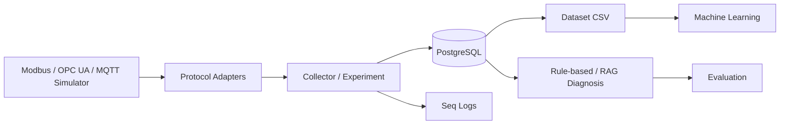

# 碩士在職專班書審專案說明

> 使用方式：將方括號內容替換為個人資訊與目標系所名稱。本文件以已完成的程式、測試與驗證為依據；尚未完成的正式實驗資料會明確標示為進行中，不應改寫為已完成成果。

## 專案名稱

**IIoT Communication Fault Diagnosis Lab：工業物聯網通訊故障診斷研究平台**

申請人：[姓名]  
申請系所：[學校／系所名稱]  
專案角色：系統設計、後端開發、通訊協定整合、實驗設計與資料分析

## 摘要

本專案建立一套可在 Windows 本機環境重複執行的工業物聯網（IIoT）通訊故障研究平台。平台以 Modbus TCP、OPC UA 與 MQTT 模擬工廠設備通訊，蒐集正常與異常情境的通訊紀錄，並保存延遲、錯誤碼、重試次數、原始請求／回應、系統資源使用量與診斷結果。

系統採用 .NET 8 Clean Architecture、PostgreSQL、Docker、Seq、EF Core 與 ASP.NET Core Web API。除規則式診斷外，也提供正式 Dataset 匯出、Python Machine Learning pipeline，以及可引用本機知識來源與歷史案例的 RAG 診斷。此平台的目的不是只展示單一通訊功能，而是建立可控制、可量測、可重複驗證的 IIoT 通訊故障研究基礎。

## 問題與動機

智慧製造現場的設備通訊故障可能來自網路、協定設定、設備端點、認證、資料格式或服務重啟。這類問題常以錯誤訊息、延遲與連線狀態呈現，排查需要同時理解工業通訊協定與系統行為。

本專案聚焦下列問題：

1. 不同協定在可控制的故障情境下，是否呈現可辨識的錯誤特徵？
2. Rule-based、Machine Learning 與 RAG 方法在故障分類與排查建議上有何差異？
3. 如何保存 Ground Truth、診斷預測與來源引用，讓實驗結果可重現與審查？

## 系統架構與已完成內容

## 實驗環境與使用的模擬器

本研究以容器化服務與外部模擬器建立可重現的工業通訊環境；所有 Simulator 都透過實際網路通訊與系統 Adapter 互動，而非直接寫入資料庫。

| 類別 | 使用工具 | 部署方式 | 實驗用途 |
| --- | --- | --- | --- |
| Modbus TCP | 自建 Docker Modbus Simulator（Python + `pymodbus`） | 專案內 `docker-compose.yml` 建置；公開 `127.0.0.1:1502` | 模擬 PLC 的 Slave ID `1` 與 Holding Registers `0–5`，供 Collector 以 Modbus TCP 實際讀取。 |
| OPC UA | Prosys OPC UA Simulation Server | Windows 外部模擬器 | 模擬 OPC UA Server、Endpoint 與 NodeId，驗證節點讀取及 Endpoint／NodeId 等故障。 |
| MQTT | Eclipse Mosquitto | Docker Compose 容器；公開 `127.0.0.1:1883` | 模擬 MQTT Broker、Topic 與 JSON 訊息發布／訂閱。 |
| 資料庫 | PostgreSQL | Docker Compose 容器 | 儲存 Device、Experiment Run、通訊紀錄、系統指標與診斷資料。 |
| 日誌 | Seq | Docker Compose 容器 | 集中檢視結構化日誌、錯誤與通訊事件。 |

其中 Modbus Simulator 並非商業 PLC 軟體，而是本專案使用成熟的 `pymodbus` 函式庫建立的輕量模擬設備。其啟動設定、暫存器值與網路連接埠皆納入版本控制，因此研究者只要執行 Docker Compose，即可在不同電腦重建相同的 Modbus 實驗條件。

| 類別 | 已完成成果 |
| --- | --- |
| 通訊協定 | Modbus TCP、OPC UA、MQTT Adapter；支援連線、讀取／訂閱、錯誤正規化與重連。 |
| 實驗平台 | Device 管理、Collector Worker、Retry、系統指標、Experiment Run、CSV 匯出。 |
| 資料品質 | `ActualFaultType` 與 `PredictedFaultType` 分開保存，避免預測污染 Ground Truth。 |
| 資料集 | 正式 Dataset 匯出與每個 Protocol／FaultType 的 Run 覆蓋率統計。 |
| ML | Docker Python/Jupyter pipeline、Run-aware Train／Validation／Test split、Logistic Regression、Random Forest、SVM 與指標輸出。 |
| RAG | 本機知識檢索、歷史案例檢索、結構化原因與建議、候選 FaultType、來源 trace、Top-1／Top-3 評估。 |
| 品質驗證 | .NET build、Unit Tests、PostgreSQL migration、Docker 服務與 RAG API 端對端驗證。 |

## 技術特色

### 1. 研究資料不被診斷結果污染

Experiment 指定的 `ActualFaultType` 為 Ground Truth；規則式、ML 或 RAG 的輸出一律寫入獨立的 `PredictedFaultType`。此設計使分類準確率與後續模型訓練可被正確評估。

### 2. 以 Experiment Run 切分 ML 資料

ML pipeline 不會把同一個 `experiment_run_id` 的紀錄同時放入訓練與測試集合，降低資料洩漏造成的虛高準確率。

### 3. RAG 結果具有來源可追溯性

RAG 回應保存候選故障、知識文章來源與歷史案例識別。研究者可檢視建議是否由實際通訊資料或知識文章支持，進一步評估 Explanation Quality 與 Hallucination Rate。

### 4. 本機可重現的研究環境

Docker Compose 管理 PostgreSQL、Seq、Mosquitto、ML 與自建 Modbus Simulator；Prosys OPC UA Simulation Server 補足 OPC UA 實驗。這些服務可重現 Modbus TCP、OPC UA、MQTT 的正常與故障條件，並與實際 Protocol Adapter 進行網路通訊。

## 目前驗證證據

可於書審附件或面試展示下列材料：

- Git commit 歷程，呈現從平台基礎、協定整合、Dataset、ML 到 RAG 的開發過程。
- Docker Desktop 的 PostgreSQL、Seq、Mosquitto 運作畫面。
- Seq 中的結構化通訊日誌與 PostgreSQL 資料表。
- Dataset coverage API 回應與 CSV 欄位。
- ML `leaderboard.csv`、metrics 與 confusion matrix。
- RAG API 回應中的候選 FaultType、原因、建議與來源。
- `dotnet build` 與 Unit Tests 的通過結果。
- Modbus 正常情境正式實驗 `MODBUS_NORMAL_100RUN_CLEAN_20261026`：100 個 Run、1,000 筆成功讀取、0 次失敗，所有紀錄的 `FaultType` 為 `None`。
- Modbus 四類正式資料（正常、ConnectionRefused、Timeout、IllegalAddress）共 400 個 Run、1,600 筆紀錄，以及依 Experiment Run 切分的初步 ML baseline。三種模型在此受控環境測試集皆為 1.000 weighted F1；此結果應描述為流程驗證與初步 baseline，而非現場泛化結論。
- MQTT 三類正式資料（正常、BrokerUnavailable、PayloadInvalid）共 300 個 Run、900 筆紀錄；其中 `PayloadInvalid` 的 100 筆紀錄皆由非 JSON 訊息觸發，且均正確標註為 `PayloadInvalid`／`JsonReaderException`。這批資料目前保留供後續跨協定實驗使用，尚未納入 ML 成績宣稱。
- OPC UA 正常情境正式實驗 `OPCUA_NORMAL_100RUN_20261028` 已完成 100 個 Run、400 筆成功讀取、0 次失敗或逾時；使用本機 Prosys OPC UA Simulation Server、endpoint `opc.tcp://localhost:53530/OPCUA/SimulationServer` 與 NodeId `i=2258`。
- OPC UA Invalid Endpoint 正式實驗 `OPCUA_INVALID_ENDPOINT_100RUN_20261028` 已完成 100 個 Run、100 筆失敗紀錄；Server 保持運作但 Collector 指向不存在的 endpoint，所有紀錄皆正確標註為 `InvalidEndpoint`／`ServiceResultException`。

## 正在進行的實驗計畫

目前已完成 Modbus TCP 的正常、Connection Refused、Timeout、Illegal Address 四種情境、MQTT 的正常、Broker Unavailable、Payload Invalid 三種情境，以及 OPC UA 的正常與 Invalid Endpoint 情境，各 100 個正式 Experiment Runs。Modbus 資料已完成受控環境的初步 ML baseline；後續將針對更多 OPC UA 故障、更多 MQTT 與更多 Modbus FaultType 收集至少 100 個不同 Experiment Runs，擴大資料的協定、設備與網路條件多樣性。

完成收集後，將比較：

| 方法 | 評估指標 |
| --- | --- |
| Rule-based | Accuracy、診斷時間、可解釋性。 |
| Machine Learning | Accuracy、Precision、Recall、F1、Confusion Matrix。 |
| RAG | Top-1 Accuracy、Top-3 Accuracy、診斷時間、Explanation Quality、Hallucination Rate。 |

## 可放入自傳或讀書計畫的段落

> 我以工業物聯網通訊故障診斷為主題，獨立規劃並實作一套可重複執行的研究平台。專案整合 Modbus TCP、OPC UA 與 MQTT，從通訊紀錄蒐集、資料庫設計、故障標註、資料集匯出，到機器學習與 RAG 診斷，建立完整的研究流程。我特別將實驗 Ground Truth 與診斷預測分離，並以 Experiment Run 避免機器學習資料洩漏，希望在研究所進一步探討不同診斷方法在工業通訊異常上的準確性、可解釋性與實務可用性。

## 建議的書審呈現方式

1. 提交 3 至 5 頁的專案摘要：問題、架構、技術特色、目前成果、後續研究問題。
2. 附上 GitHub 或程式碼連結，並以 README 作為操作與驗證依據。
3. 製作 3 至 6 張截圖：系統架構、Docker／Seq、資料庫、Dataset、ML、RAG。
4. 面試時以「一次故障從 Simulator 到 RAG 診斷」展示完整流程。
5. 以「平台已完成、正式資料收集中」描述進度，避免把 exploratory 或 smoke-test 結果寫成正式研究結論。

## 後續需補上的個人資訊

- 與現職工作相關的問題情境、技術痛點與專案動機。
- 想研究的教授、實驗室或課程如何與本專案連結。
- 申請系所要求的研究計畫篇幅、格式與截止日期。
- 正式資料收集後的量化結果與圖表。
