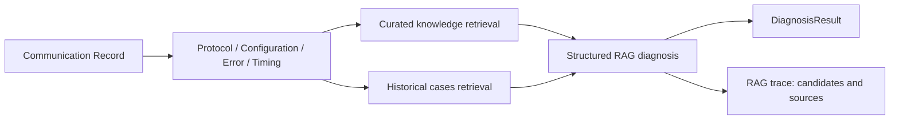

# Phase 10 RAG 診斷與評估

## 診斷資料流



## 知識與輸入範圍

本機知識庫收錄 Modbus TCP、OPC UA 與 MQTT 的常見故障案例，包含 Connection Refused、Timeout、Illegal Address、Invalid Endpoint、Invalid NodeId、Certificate Error、Broker Unavailable、Authentication Failed、Topic Mismatch 與 Payload Invalid。

RAG 檢索輸入只有通訊觀測資料與裝置設定：協定、Host、Port、status、observed fault type、error code、error message、response time、retry count，以及最多三筆相同協定的歷史通訊案例。`Experiment.ActualFaultType` 不在檢索輸入中。

## API

```text
POST /api/communication-records/{recordId}/rag-diagnose
GET  /api/experiments/{experimentId}/rag-evaluation
```

第一個端點會保存 `DiagnosisResult`，其 `diagnosisMethod` 為 `Rag`。同時會保存 `rag_diagnosis_traces`，其中包含 Top-3 候選 FaultType、知識文章 ID、歷史案例 ID 與 provider。trace 讓候選結果可被重現與審閱。

第二個端點只評估帶有 RAG trace 的實驗紀錄：

| 指標 | 定義 |
| --- | --- |
| Top-1 Accuracy | `predicted_fault_type` 等於 Experiment Ground Truth 的比例。 |
| Top-3 Accuracy | Ground Truth 出現在儲存的三個候選 FaultType 中的比例。 |
| Average Diagnosis Duration | 該實驗 RAG 診斷的平均處理時間（毫秒）。 |
| Explanation Quality | 研究者依來源是否支持原因與建議進行人工評分。 |
| Hallucination Rate | 原因或建議無法由引用知識文章或通訊紀錄支持的比例。 |

## 資料庫 migration

Phase 10 新增 `rag_diagnosis_traces` 表。Docker PostgreSQL 啟動後執行：

```powershell
dotnet tool run dotnet-ef database update --project src/IIoT.FaultDiagnosis.Infrastructure --startup-project src/IIoT.FaultDiagnosis.Api
```

## 外部 LLM

目前預設為本機知識檢索與可追溯的結構化回應，不會自動傳送資料到雲端。串接外部 LLM 前，研究者應決定模型供應商、API 金鑰管理、傳輸資料最小化、prompt／模型版本保存與資料保留規則。外部模型輸出仍應以本機 RAG sources 為依據，並接受 Explanation Quality 與 Hallucination Rate 的人工審閱。
